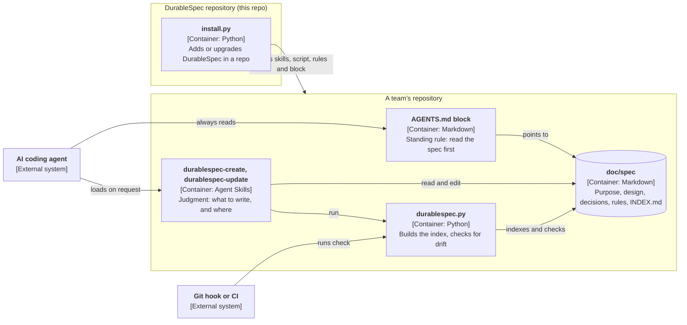

# Architecture

DurableSpec does three kinds of work, and each lives where it fits
([ADR-0001](../adr/0001-three-homes-skills-script-agents-md.md)):

| Work | Example | Home |
|---|---|---|
| Judgment | Should this change touch the spec? Which document owns it? | Two Agent Skills ([skills](skills.md)) |
| Mechanical checks | Index current? `owns:` paths exist? ADR numbers unique? | One stdlib script ([check script](check-script.md)) |
| Standing behavior | Read the spec before deciding anything | A block in `AGENTS.md` ([rules](rules.md)) |



The [installer](installer.md) puts these in a user's repository:

```
user's repo
  .agents/skills/durablespec-{create,update}/   copied from skills/
  .claude/skills/durablespec-*                  links to the above, for Claude Code
  doc/spec/durablespec.py                       copied from template/, always replaced
  doc/spec/README.md                            copied from template/, only if missing
  AGENTS.md                                     marked block from template/AGENTS-block.md
  CLAUDE.md                                     an "@AGENTS.md" line
```

After that, DurableSpec has no runtime presence. The user's agent reads `AGENTS.md`, loads a skill when a
request matches, and the script runs locally, in a git hook or in CI. Nothing calls home.

The repository README is the public introduction; its image is `doc/durablespec-hero.jpg`. The product page and the
comparison with other spec tools are on [pikelabs.ai](https://pikelabs.ai/durablespec), maintained in a
separate website repository.
