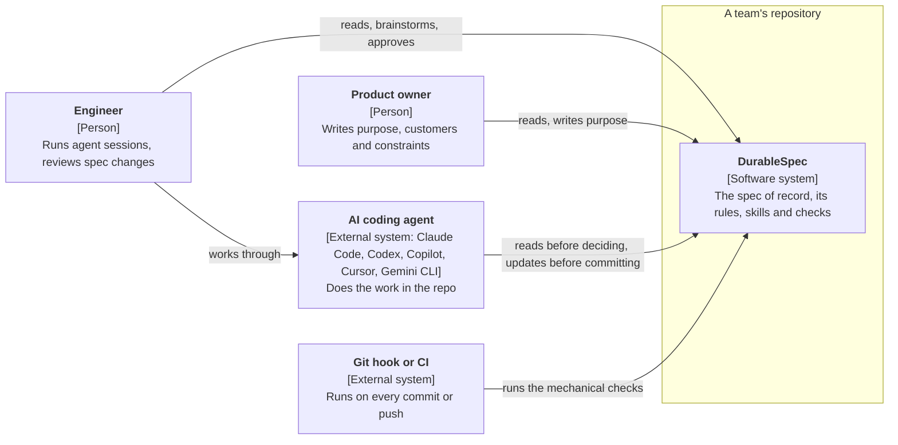

# DurableSpec

DurableSpec keeps a short spec of record, `doc/spec/`, in each repository: what the system is for, how
it is shaped, and why it was built that way. People and AI agents read it before deciding anything and
update it before committing. Usually nothing needs to change.

## The problem

The most valuable context about a system is not in its code: who the customers are, what the business
needs, why the architecture is shaped this way, which options were rejected. That context lives in
people's heads and in AI sessions that end. With several engineers, product owners, managers and AI
agents working on one system, each holds a different, partial picture, and every new session starts
from zero. Agents fill the gap by guessing, and the guesses pile up.

## Context

## Who it is for

- **Teams building with coding agents,** where several people each run their own sessions on one system.
- **Product owners and business people,** who hold the purpose and constraints and can write them in
  plain language.
- **Individual engineers,** whose next session starts from what the last one settled.

## What it is not

Not a workflow for planning or building changes (Spec Kit, OpenSpec and Kiro do that, and DurableSpec
sits alongside them). Not a mirror of the code: the code stays the authority on how. Not tied to any
agent or model. See [ADR-0006](../adr/0006-manage-knowledge-not-process.md).

## Origin

The practice grew out of daily use across Pike Labs repositories from spring 2026, and was packaged for
others in October 2026, first as OneSpec and then as DurableSpec ([ADR-0005](../adr/0005-name-durablespec.md)).
The product page is [pikelabs.ai/durablespec](https://pikelabs.ai/durablespec).
